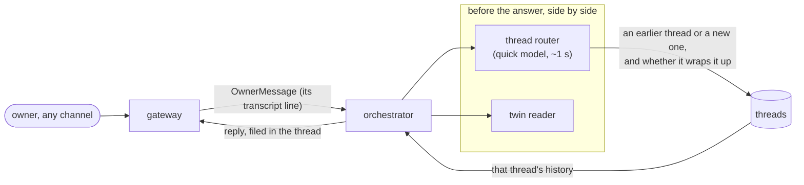
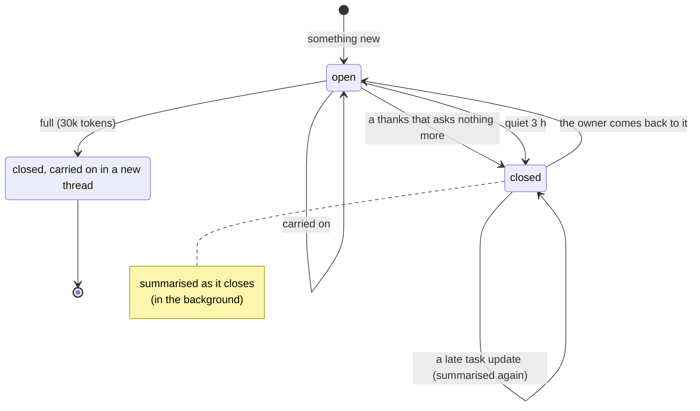
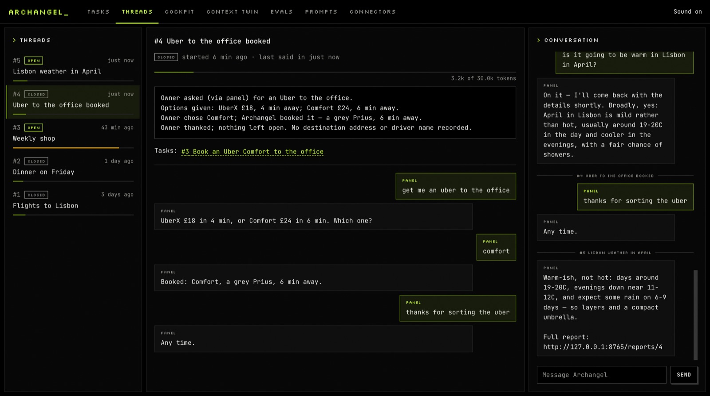

# Threads

One conversation with the owner, kept as many threads, one per topic. Before each answer a quick model puts what the owner said in its thread, an earlier one or a new one, and the orchestrator answers seeing that thread, not the last forty messages of everything. M18 in the roadmap. Proposed by the owner 2026-11-17.

## Why

Until threads, the orchestrator saw the last 40 messages, whatever they were about. An old topic fell out even when it mattered ("for the India flights, how much were they?" a week later), and unrelated ones crowded in, at a cost on every call. A mistaken belief in those 40 messages kept steering it too: on 2026-11-17 it went on refusing PC tasks because of its own earlier refusals.

## How a message flows



1. The gateway records the owner's line in the transcript and hands it on with its id.
2. The orchestrator asks the router and the twin's reader at once (both are model calls; the reader takes longer, so routing adds nothing to the wait).
3. The router reads where the conversation is (the thread Archangel spoke in last, shown apart) and the other recent threads (a summary each, or how an unfinished one ends), and answers: the thread this carries on, or a new one with a title, and whether it wraps its thread up. For anything older it has `search_threads`.
4. The orchestrator answers with that thread's history, plus a line about the others. Its reply, the owner's line and any task it starts are filed under the thread.

## Where each event goes

| Event | Thread |
|---|---|
| Something the owner says | The router's choice. If the router fails: where the conversation is. |
| A task's update | The thread that started it (`Task.thread`), however the conversation has moved on, or what carried it on if it was full. No model call. |
| A notice (voicemail, the twin's notes, a shared location) | The latest thread. |

A task from before threads has no thread: its update goes to the latest.

## A thread's life



- **Closing.** The router judges whether the owner wrapped the thread up: a thanks or goodbye that asks for nothing. Not a keyword list: "thanks, and can you book a table?" is a new topic, not a wrap-up. Once answered, the thread closes and is summarised in the background.
- **Quiet threads** (nothing said for 3 hours) are summarised and closed too, so every finished thread has a summary for the router and for search.
- **Summaries** are a few lines keeping the concrete facts (prices, names, times, links, task numbers) and what's left open, and they retitle the thread. Written by the main model (in the background, so it can think). A thread said more in after its summary (a task update arriving late) is summarised again.
- **Reopening.** A closed thread the owner comes back to opens again with its whole history.
- **Full.** Each thread records how big the orchestrator's last call in it was, in tokens (its `size`). At 30,000 (`FULL`) the next message (or task update) carries on in a new thread at once; the full one's summary, which the new one starts from, follows in the background, and until it does the orchestrator is told to read the full one if it needs to. Nothing silently falls out of the context. The old 40-message trim stays only as a backstop, at 100 messages.
- **Said in counts from the moment it's routed**, so a summary being written as the owner comes back can't close the thread under them: a summary only closes a thread nothing was said in since it was read. A summary that fails is tried again an hour later, not every minute.

## What the orchestrator sees

Its situation gains three lines:

```
You're in thread #15, "Text Anselm", started 2 min ago.
It carries on #12, "Flights to India", which went: …        (only for a continuation)
Other recent threads (search_threads and read_thread for what was said in any): #14 "Flights to India" (closed, 8 days ago); …
```

The task list marks tasks started in other threads (`(thread #14)`). Two tools: `search_threads(words)` (every thread, full-text) and `read_thread(id)` (its summary and what was said, the end of a long one). If the router picks wrong, the orchestrator can still fetch what the owner means.

## Code

`agent/threads/`:

| File | Role |
|---|---|
| `__init__.py` | `Threads`: what the orchestrator uses. `route(event)`, `history`, `save`, `describe`, `tools`, `watch` (summarises finished threads every minute). Holds the rules: reopening, closing, carrying a full thread on. |
| `store.py` | `ThreadStore`: the only code on the thread tables. A thread's history (Pydantic AI JSON), its state, and a full-text index (SQLite FTS5) of its title, summary and what was said. Adopts the conversation from before threads as the first thread, "Before threads". |
| `router.py` | `Router.choose(said, recent) → Choice(thread, title, closes)`: the quick model, no reasoning. Told to fix an impossible choice (a thread that doesn't exist, a new one without a title). |
| `summariser.py` | `Summariser.summarise(thread, said, before) → Summary(title, summary)`. |
| `text.py` | A thread's history as plain lines (what was said, tool calls as short notes), and `ago`. |

Storage, in `data/archangel.db`: `threads`, `thread_history`, `thread_text` (FTS5), and a `thread` column on `transcript` and `tasks`. The old one-row `history` table is adopted on first start, in one transaction (the last 40 messages, as the orchestrator saw them; everything said and every task until then is filed under it), and dropped. Rolling back to before threads would start the conversation afresh (the adopted history stays in `thread_history`); rolling forward again would adopt that stretch as a second "Before threads".

The prompts are editable on the panel like the rest ("thread router", "thread summariser").

## Panel

- **Threads** tab (`/threads`, `/threads/{id}`): the threads, newest first, each open or closed, how long ago, and a bar for how full it is (amber when nearly). One opened: its summary (or when it'll get one), size, what it carries on from, its tasks (links), and everything said in it.
- **Chat**: a quiet rule with the thread's name where the conversation moves to another thread; click it to open the thread.
- **Tasks**: each links to its thread.
- **Cockpit**: the thread router and summariser are parts of their own, called by the orchestrator (or, for quiet threads, by `threads`).



## Evals

`just threads-eval [filter] [--runs N]` runs the router on the real model against a made-up owner's twelve past threads (`apps/agent/evals/threads/cases.toml`; never the real owner's): answering the question just asked, "yes the cheaper one", "for the flights to India, how much were they again?" (last week's, not last year's), a plumber from two months back that only search finds, new topics, a thanks that wraps up and one that asks for more, a change of subject, and a thanks after the conversation moved threads.

First runs, 2026-11-17, on `deepseek/deepseek-v4.1-flash`:

- 36/36 on the first 12 cases, ~1 s each.
- Harder cases found two faults: the model took the highest thread number for the newest, so "great thanks" went to an older thread (1/6); and a thanks with a new ask closed the old thread. Fixed by showing where the conversation is apart from the rest, and by saying `closes` is only for a thanks that asks nothing.
- Then 85/85 (17 cases × 5).

## Limits

- The router is a model: it can put a message in the wrong thread. The orchestrator still sees the other threads' names and can search and read them, so it can recover what it needs, but its answer lands in the thread chosen.
- A notice goes to the latest thread, not necessarily the one it's about.
- The chat's marks are worked out in the browser: an owner's newest line isn't filed yet when it arrives, so it's shown in its answer's thread; if a task's update lands between the two, it can show under the wrong one until a reload.
- Search is by words, not meaning: "the cheap flights" finds "flights", not a thread that only said "fares".
- Summaries are a model's: they can leave out what turns out to matter later. The thread's whole history stays, and `read_thread` reads it.
